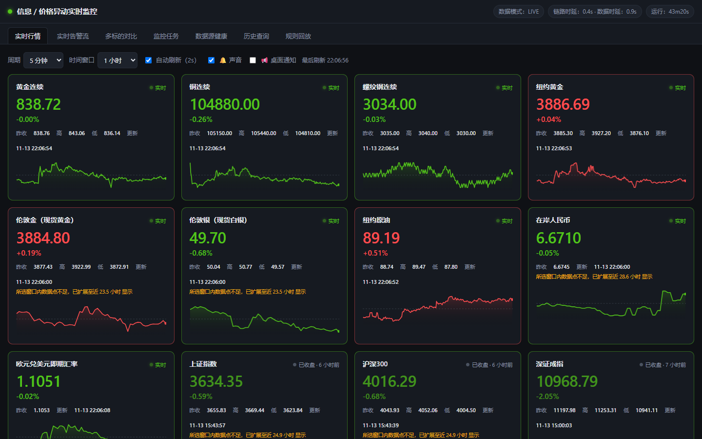
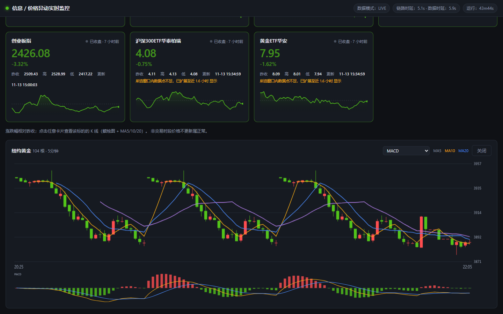
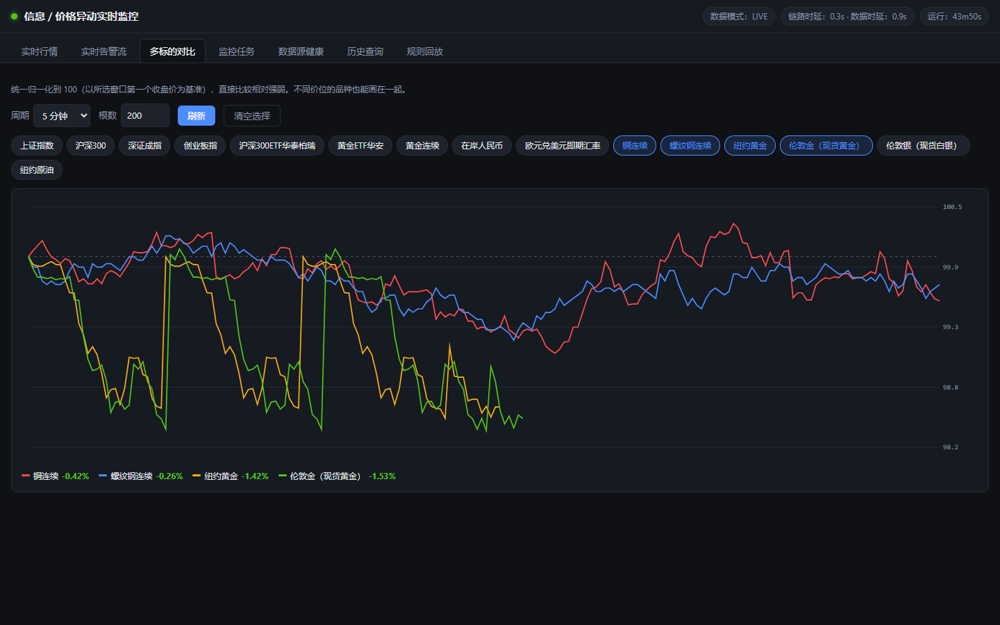
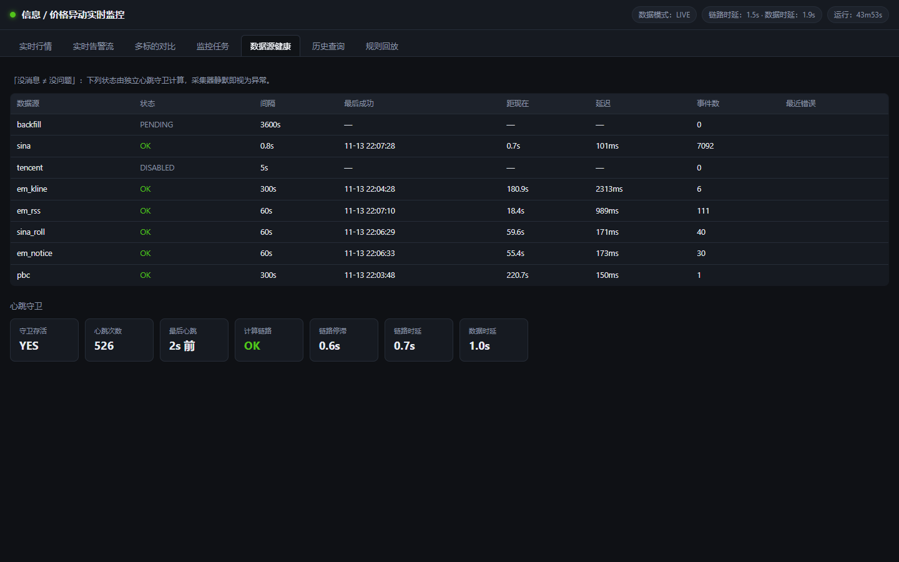

# 实时异动监控 · Realtime Monitor

[](https://www.python.org/)
[](LICENSE)
[](#外部依赖)
[](#快速开始)
[](#sse-幂等)

对接**真实公开数据源**的轻量流式监控系统。单进程、零第三方依赖、纯 Python 标准库。

盯盘 + 异动告警 + 多源信息监控，一个 `python run.py` 跑起来。

> ⚠️ **仅供个人学习与自用**。数据来自非官方公开接口，商用需向持牌数据商购买授权。
> 详见 [DISCLAIMER.md](DISCLAIMER.md)。

```
┌─────────────┐   ┌──────────────┐   ┌─────────────┐   ┌──────────────┐
│  采集层      │ → │  事件总线     │ → │  计算层      │ → │  告警决策     │
│ 8 个数据源   │   │ SQLite 日志   │   │ 分区水位线   │   │ 去重/冷却    │
│ 0.8s 轮询    │   │ 有序可重放    │   │ event_time   │   │ 分级/聚合    │
└─────────────┘   └──────────────┘   └─────────────┘   └──────────────┘
                                                              ↓
┌─────────────┐   ┌──────────────┐   ┌─────────────┐   ┌──────────────┐
│  Web 看板    │ ← │  SSE 推送     │ ← │  K线/指标    │ ← │  P1/P2/P3    │
│ 原生 JS      │   │ 幂等续传      │   │ MA/MACD/KDJ │   │  resolved    │
└─────────────┘   └──────────────┘   └─────────────┘   └──────────────┘
```

## 特性

- **零依赖**：只用 Python 3.9+ 标准库，不需要 pip install 任何东西
- **真数据**：新浪 / 腾讯 / 东方财富 / 央行，无 mock
- **流计算**：基于 `event_time` 的分区水位线 + 滑动窗口，不是定时脚本
- **可重放**：所有事件落盘，支持按时间区间回放对比规则
- **自监控**：「没消息 ≠ 没问题」，采集静默立即告警
- **K 线**：快照聚合 OHLCV，MA / MACD / KDJ / BOLL / 量均线
- **盯盘**：声音提醒 + 桌面通知 + 多标的归一化对比

## 快速开始

```bash
git clone https://github.com/Daryl-herna/realtime-monitor.git
cd realtime-monitor
python run.py
```

打开 <http://127.0.0.1:8848/>

Windows 用户也可以双击 `启动.bat`。

| 参数 | 说明 |
|---|---|
| `--config path.json` | 指定配置文件（默认 `config.json`） |
| `--port 9000` | 覆盖端口 |
| `--no-collect` | 只启动看板，不启动采集（离线查看历史） |

## 截图

| 实时行情 | K 线 + MACD |
|---|---|
|  |  |

| 多标的对比 | 数据源健康 |
|---|---|
|  |  |

> 截图待补充：运行后自行截取放入 `docs/images/`。

## 技术栈

| 层 | 选型 | 为什么 |
|---|---|---|
| 运行时 | Python 3.9+ | 标准库够用 |
| 存储 | SQLite (WAL) | 单文件、免部署、支持并发读 |
| 事件总线 | SQLite `events` 表 | 自增 seq 提供全序，天然可重放 |
| Web | `http.server` | 免装框架 |
| 前端 | 原生 JS + Canvas | 无构建、无 npm |
| 流计算 | 自实现分区水位线 | 不引入 Flink/Spark |

## 文档

- [S0 数据源清单与技术选型](docs/S0-数据源候选清单与技术选型.md)
- [验收测试脚本](docs/acceptance.py)
- [免责声明与使用条款](DISCLAIMER.md)

---

## 定位：盯盘助手，不是炒股软件

这个系统是**异动监控 + 盯盘辅助工具**，不能替代炒股软件。差距是结构性的：

| 能力 | 炒股软件 | 本系统 |
|---|---|---|
| 推送频率 | Level-2，每秒 2-3 笔 | 最快 1 秒/轮，快照式 |
| 盘口/逐笔 | 买五卖五、逐笔成交 | 无 |
| K 线 | 1/5/15/30/60 分、日周月 | **有**（由快照聚合，1/5/15/60 分钟） |
| 技术指标 | 几十种 | **MA5/10/20 + MACD + KDJ + BOLL + VMA5/10** |
| 标的数量 | 全市场 5000+ | 15 个（可配置） |
| 下单交易 | 对接券商 | 无 |
| 数据合规 | 持牌授权 | 非官方接口，仅限自用 |

**擅长**：多源异动监控（价格+新闻+公告+央行）、规则化告警、历史回放。
**不擅长**：短线交易、选股、盘口分析。

### 采集密度

实测把轮询从 5 秒提到 **1 秒**后：

| 标的 | 5 秒轮询 | 1 秒轮询 | 提升 |
|---|---|---|---|
| 沪铜/螺纹/沪金 | 1.3 条/分钟 | **23 条/分钟** | 17× |
| 纽约黄金/原油 | — | 20-22 条/分钟 | — |
| 欧元/美元 | — | 9 条/分钟 | — |
| 伦敦金/银、在岸人民币 | — | 0.9 条/分钟 | 源本身分钟级 |

1 秒轮询实测 19/20 成功，平均延迟 111ms，未触发限流。

## 看板

打开后默认是 **实时行情** 页：

- 每个监控标的一张卡片：**大字实时价格**、涨跌幅、昨收/最高/最低、更新时间
- 卡片下方是**走势图**（Canvas 手绘，无图表库依赖）
- **红涨绿跌**（A 股习惯）
- 价格变化时卡片闪烁提示
- 顶部显示链路时延与数据时延
- 时间窗口可切：5 分钟 / 15 分钟 / 30 分钟 / 1 小时 / 4 小时 / 全天
- 每张卡片右上角有**实时状态灯**：
  - 绿点「实时」= 数据源时间还在前进（真正在更新）
  - 灰点「已收盘 · N 小时前」= 该品种当前交易时段已结束

### 关于「实时」的诚实说明

不同品种的交易时段不同，**A 股和国内期货在夜间就是不动的**：

| 品种 | 代码 | 交易时段 | 夜间 |
|---|---|---|---|
| 上证指数 | `sh000001` | 9:30-15:00 | 停 |
| 沪深300 | `sh000300` | 9:30-15:00 | 停 |
| 深证成指 | `sz399001` | 9:30-15:00 | 停 |
| 创业板指 | `sz399006` | 9:30-15:00 | 停 |
| 沪深300ETF | `sh510300` | 9:30-15:00 | 停 |
| 黄金ETF | `sh518880` | 9:30-15:00 | 停 |
| 沪金/沪铜/螺纹 | `nf_AU0` `nf_CU0` `nf_RB0` | 9:00-15:00 | 停 |
| 伦敦金/伦敦银 | `hf_XAU` `hf_XAG` | 近 24 小时 | 动（分钟级） |
| 纽约黄金/白银 | `hf_GC` `hf_SI` | 近 24 小时 | **动（秒级）** |
| 纽约原油/布伦特 | `hf_CL` `hf_OIL` | 近 24 小时 | **动（秒级）** |
| 在岸人民币 | `fx_susdcny` | 近 24 小时 | 动（分钟级） |
| 欧元/美元 | `fx_seurusd` | 24 小时 | 动（秒级） |

**数据源刷新粒度**：新浪的 `hf_*`（外盘）和 `fx_*`（外汇）快照本身是**按分钟刷新**的，
我们 5 秒抓一次，但源时间一分钟才动一次。这是数据源的粒度，不是系统故障。
系统把实时性定义为「数据源允许的最小刷新间隔」，界面上如实标注。

若需要真正秒级的黄金，东方财富 `push2` 的 `122.XAU` 实测是秒级（`f86` 字段为秒级时间戳），
但该接口对同一 IP 有严格频率限制，连续请求会 `RemoteDisconnected`，因此未作为默认源。

**点击任意卡片**打开该标的的 K 线面板：
- 蜡烛图（红涨绿跌），周期可选 1/5/15/60 分钟
- 三条均线：MA5（黄）、MA10（蓝）、MA20（紫）
- 副图可切换：**成交量+量均线 / MACD / KDJ / BOLL**（BOLL 叠加到主图）
- 每 5 秒自动刷新

### 声音提醒与桌面通知

盯盘的核心是「人不在屏幕前也知道有事」。告警到达时：

- **声音**：P1 三连高音、P2 两连中音、P3 单短音（WebAudio 合成，无音频文件，离线可用）
- **桌面通知**：页面在后台也弹出系统通知，P1 需手动关闭
- **右下角提示**：6 秒自动消失

两个开关在行情页工具栏，可随时关闭。

> **浏览器限制**：页面必须先被点击过一次才能播放声音（自动播放策略）。
> 打开看板后点一下页面即可。桌面通知需要在弹窗里允许一次。

### 多标的对比

「多标的对比」页：勾选任意标的（最多 10 个），统一**归一化到 100**（以窗口内第一个收盘价为基准），
直接比较相对强弱。沪铜 10 万和螺纹钢 3 千能画在同一张图上。

图例显示各标的的相对涨跌幅，红涨绿跌。

其余标签页：实时告警流、监控任务、数据源健康、历史查询、规则回放。

## 架构

```
采集层 (7 个 collector, 各自限速+指数退避)
   ↓ 统一转成带 event_time 的结构化事件
事件总线 (SQLite events 表 = 有序日志; 自增 seq; 可重放; consumer_offsets 记录 ACK)
   ↓ 内存队列分发，空闲回落 DB 轮询（不丢事件）
计算层 (分区水位线 + event_time 滑动窗口；迟到策略 drop/recompute)
   ↓
规则引擎 (价格规则 5 类 + 信息规则 5 类，全部来自任务配置)
   ↓
告警决策 (fingerprint 去重 → 冷却 → P1/P2/P3 分级 → 静默期 → 聚合 → resolved 闭环)
   ↓
推送层 (SSE + Last-Event-ID 幂等续传)
   ↓
看板 (单页 HTML + 原生 JS，无构建)

自监控 (独立心跳线程，采集静默即告警)
```

### 为什么不是「定时脚本套壳」

| 要求 | 实现 |
|---|---|
| 带 event_time 的事件 | 每条事件有 `event_time`（数据源标注时间）与 `ingest_time`（入库时间），二者分开记录 |
| 有序、可重放、可 ACK | `events.seq` 提供全序；按 `event_time` 区间查询即回放；`consumer_offsets` 持久化位点 |
| 基于 event_time 的窗口 | `app/stream.py` 的 `SeriesWindow` / `WindowStore`，按事件时间二分查找，绝不用处理时间 |
| 水位线 | `WatermarkSet` 按 `(kind, source)` **分区**维护 |
| 迟到数据策略 | `stream.late_policy` = `drop`（默认，计入 late_dropped）或 `recompute` |

**分区水位线是必须的**：行情是「此刻」的时间戳，新闻是「发布时刻」的时间戳。
若用一条全局水位线，一条刚发布但标注 2 小时前的新闻会把水位线推错，导致大量正常数据被判迟到丢弃——
这不是迟到策略，是丢数据。开发过程中真实踩到过这个坑（176 条事件被误丢），修复后按分区各自推进。

---

## 数据源

| 源 | 内容 | 间隔 | 状态 |
|---|---|---|---|
| `sina` | 新浪行情：上证指数 / 沪深300 / 黄金主力 / USD-CNY | 5s | 已验证 |
| `tencent` | 腾讯行情（美股）—— **已按需求停用** | — | 已禁用 |
| `em_kline` | 日线基线（20 日高低点、均量），供突破/放量规则用 | 300s | 已验证（东财限流时自动降级到腾讯） |
| `em_rss` | 东方财富 RSS 财经资讯 | 60s | 已验证 |
| `sina_roll` | 新浪财经滚动新闻 | 60s | 已验证 |
| `em_notice` | 东方财富 A 股公告 | 60s | 已验证 |
| `pbc` | 中国人民银行·沟通交流 | 300s | 已验证 |

**降级链**：`em_kline` 首选东财 `push2his`，失败自动切腾讯 `ifzq.gtimg.cn`，界面上 `provider` 字段可看出当前用的哪个。
实测中东财接口会因频率触发 `RemoteDisconnected`，这条降级链是必需而非装饰。

### 合规声明

- 上述行情接口均为**非官方公开接口**，无 SLA。自用研究可接受，**商用需向交易所或持牌数据商购买授权**。
- 采集器实现了自适应限速与指数退避（连续失败最多退到 8 倍间隔），不绕过反爬、不伪造登录态。
- 免费公开源**不承诺毫秒级实时**。系统把实时性定义为「数据源允许的最小刷新间隔」，界面常驻显示实际延迟。

---

## 规则配置

规则全部写在任务里（`tasks` 表的 `config` 字段），可在看板「监控任务」页运行时增删改启停，**无需重启**。

### 价格规则

| type | 参数 | 含义 |
|---|---|---|
| `change_pct` | `threshold` | 相对昨收的涨跌幅绝对值超阈值 |
| `window_change_pct` | `window_s`, `threshold` | N 秒窗口内变动率 |
| `breakout` | `days`, `direction`(up/down/both) | 突破 N 日高/低点 |
| `volume_spike` | `multiple` | 成交量超过 N 日均量的倍数 |
| `abs_price_band` | `min`, `max` | 价格越出指定区间 |

### 信息规则

| type | 参数 | 含义 |
|---|---|---|
| `new_item` | — | 出现此前未见过的条目（按内容哈希） |
| `new_content` | — | 同 `new_item`，语义化别名 |
| `keyword` | `keywords[]` | 标题+摘要命中关键词 |
| `regex` | `pattern` | 正则命中 |
| `field_change` | — | 同一条目的内容哈希发生变化（结构化 diff 的判定基础） |

每个任务还可配 `cooldown_s`（冷却秒数）、每条规则可配 `severity`（P1/P2/P3）。

### 示例：新增一个任务

```json
{
  "id": "t-my-stock",
  "name": "我的自选股",
  "type": "price",
  "enabled": true,
  "config": {
    "subjects": ["sh600519"],
    "cooldown_s": 300,
    "rules": [
      { "id": "pct", "type": "change_pct", "threshold": 3, "severity": "P1" },
      { "id": "win", "type": "window_change_pct", "window_s": 600, "threshold": 1.5, "severity": "P2" }
    ]
  }
}
```

要监控新的标的，还需在 `config.json` 的 `watchlist.sina` 里加上对应 symbol（采集层才知道去拉）。

---

## 告警决策

| 机制 | 实现 |
|---|---|
| **fingerprint 去重** | 价格：`任务+规则+标的`（同因聚合）；信息：`任务+规则+条目`（每篇文章是独立的因） |
| **冷却窗口** | 同 fingerprint 在 `cooldown_s` 内只推一次，抑制次数记入 `suppressions` 表并在界面可见 |
| **分级** | P1 立即推送；P2 立即推送（冷却较长）；P3 进摘要队列 |
| **聚合** | P3 每 `digest_interval_s` 合成一条摘要，避免告警风暴 |
| **静默期** | `alerts.silence_windows` 配置时间段，期间只计抑制不推送 |
| **风暴熔断** | 每分钟超过 `max_alerts_per_minute` 条即熔断，其余计抑制 |
| **resolved 闭环** | 条件恢复后延迟 `resolve_after_s` 再发 `resolved`，避免抖动 |

冷却状态在重启时会从 `alerts` 表恢复，否则重启瞬间会重复推送同一异动。

---

## 自监控：「没消息 ≠ 没问题」

独立心跳线程（`app/heartbeat.py`）每 `tick_s` 秒检查：

- 每个数据源距上次成功多久 → `OK` / `STALE`（>间隔×3）/ `DOWN`（>间隔×8）/ `PENDING` / `DISABLED`
- 计算链路距上次处理事件多久 → 超过 `pipeline_stale_s` 判 `STALE`
- 守卫自身的心跳时间也暴露在界面上，能看出守卫是否还活着

界面顶部常驻两个延迟口径：

- **链路时延** = 最新事件入库到现在的间隔（判断链路是否还活着）
- **数据时延** = 数据源标注时间到现在的间隔（新闻天然滞后，不能拿来判断故障）

任一数据源降级或链路停滞，顶部会出现红色横幅：
「⚠ 数据源降级：xxx —— 当前看到的「无告警」不代表正常」。

---

## SSE 幂等

- 每条告警带 `event_id`（= alert_id，由 fingerprint+时间戳哈希得到）
- 断线重连时浏览器自动带 `Last-Event-ID`，服务端从内存环形缓冲（最近 500 条）补发该 ID 之后的消息
- 库内 `alerts.alert_id` 唯一约束 + `INSERT OR IGNORE`，重复投递不会产生重复记录
- 前端按 `event_id` 去重渲染

---

## 回放

看板「规则回放」页：选任务 + 时间区间 + 可选的新规则 JSON，系统从 `events` 表读取历史事件，
分别用当前规则和新规则跑一遍，给出「仅旧规则命中 / 仅新规则命中」的差异列表。

回放不污染实时状态（`record_state=False`），回放记录写入 `replays` 表。

命令行也可以：

```bash
curl -X POST http://127.0.0.1:8848/api/replay \
  -H "Content-Type: application/json" \
  -d '{"task_id":"t-index-pct","from":1794400000000,"to":1794460000000,
       "new_config":{"subjects":["sh000001"],"rules":[{"id":"t","type":"change_pct","threshold":0.5,"severity":"P1"}]}}'
```

---

## 配置说明

```json
{
  "server":  { "host": "127.0.0.1", "port": 8848 },
  "storage": { "db_path": "data/monitor.db", "retention_days": 30 },
  "bus":     { "poll_interval_ms": 100, "batch_size": 200 },
  "stream":  { "allowed_lateness_ms": 3000, "late_policy": "drop", "window_grace_ms": 2000 },
  "alerts":  {
    "default_cooldown_s": 300,
    "silence_windows": [],
    "digest_interval_s": 120,
    "resolve_after_s": 300,
    "max_alerts_per_minute": 30
  },
  "heartbeat": { "tick_s": 5, "stale_factor": 3.0, "down_factor": 8.0, "pipeline_stale_s": 120 },
  "sources":   { "sina": { "enabled": true, "interval_s": 5, "min_interval_s": 3 }, ... },
  "watchlist": { "sina": [ { "symbol": "sh000001", "name": "上证指数", "class": "index", "enabled": true } ] }
}
```

- `interval_s` 不得小于 `min_interval_s`，启动时校验
- `class` 决定解析方式：`index` / `futures` / `fx`
- 配置改动后保存即可，采集器下一轮生效

---

## 目录结构

```
realtime-monitor/
├── 启动.bat               双击启动（Windows）
├── run.py                 命令行启动
├── config.json            配置（与代码分离）
├── app/
│   ├── main.py            装配与生命周期
│   ├── config.py          配置加载/校验/热更新
│   ├── db.py              SQLite schema 与连接管理
│   ├── bus.py             事件总线（有序/可重放/ACK）
│   ├── stream.py          分区水位线 + event_time 窗口
│   ├── rules/engine.py    规则引擎（价格 5 类 + 信息 5 类）
│   ├── alerts.py          告警决策（去重/冷却/分级/聚合/恢复）
│   ├── pipeline.py        计算链路 + SSE Hub + 回放
│   ├── heartbeat.py       独立心跳守卫
│   ├── tasks.py           任务 CRUD 与默认任务
│   ├── server.py          HTTP + SSE
│   └── collectors/
│       ├── base.py        限速/退避/健康上报
│       ├── quotes.py      新浪/腾讯/基线
│       └── news.py        RSS/滚动/公告/央行
├── static/                看板（HTML/CSS/JS，含 Canvas 走势图）
├── data/monitor.db        SQLite（自动创建）
└── docs/                  S0 清单、验收脚本、探测记录
```

---

## 外部依赖

**零第三方依赖**，仅用 Python 3.9+ 标准库：`sqlite3`、`http.server`、`urllib`、`threading`、`queue`、`json`、`re`、`xml.etree`。

若日后需要：

| 想加的东西 | 用途 | 不装也能跑的替代 |
|---|---|---|
| `requests` | HTTP 客户端 | 已用 `urllib.request` |
| `Flask` / `FastAPI` | Web 框架 | 已用 `http.server` |
| Redis Streams | 事件总线 | 已用 SQLite `events` 表 |
| `pandas` | 回放分析 | 回放用纯 Python 遍历 |

---

## 踩过的坑（都已在代码中修复）

| 问题 | 症状 | 原因 | 修复 |
|---|---|---|---|
| 全局水位线 | 176 条正常事件被判迟到丢弃 | 行情是「此刻」、新闻是「发布时刻」，混用一条水位线 | 按 `(kind, source)` 分区 |
| 批量入库顺序 | 同批事件只剩第一条 | 列表接口是「新→旧」，第一条把水位线顶到最新 | 按 event_time 升序发布 |
| 种子任务未重载 | 一切正常但永不告警 | Pipeline 构造时任务表为空，种子写入后没重载 | 种子后调用 reload_tasks |
| 任务作用域失效 | 央行任务抓了全部新闻 | 规则引擎不看任务的 subjects/sources | 加 `_matches()` 过滤 |
| 信息类指纹过粗 | 一批公告只剩一条告警 | 同任务同规则共用一个指纹 | 指纹按条目区分 |
| 冷却状态不持久 | 重启后重复推送同一异动 | 内存字典重启清空 | 启动时从 alerts 表恢复 |
| 延迟口径失真 | 数据时延显示 -17505 秒 | 公告 `notice_date` 只有日期，被当精确时刻 | 00:00:00 视为批次；`make_event` 全局夹回当前时间 |
| 看板打开空白 | 已发生的告警看不见 | 只接新推送，不加载历史 | 首次连接拉最近 50 条 |
| 曲线画成平线 | 收盘后价格不变 | 重复快照挤占抽样名额 | 先压缩连续相同价格再抽样 |
| 新标的不显示 | 加进配置但卡片消失 | 事件去重后不再产生新事件，看板读不到 | 采集器快照直通看板层 |
| 美股 28 小时未更新 | 时间戳荒谬 | 腾讯美股时间戳是**美东时间**，按北京时间解析 | 按时区转换（含夏令时）—— 美股后已整体移除 |
| 任务标的没跟上 | 新标的永不触发告警 | 种子只插入不覆盖 | 内置任务每次启动同步配置 |
| 同一快照重复入库 | 伦敦金每分钟 5 条、美股告警重复 | `event_id` 哈希含 `event_time`，不同解析路径算出不同值 | 有 `dedup_key` 时以它为准 |

## 已知限制

1. **A 股行情在非交易时段不更新**。午休（11:30–13:00）和收盘后，行情事件会重复同一个快照，被 dedup_key 去重后不再入库，界面表现为「链路时延上升」，这是正确行为不是故障。
2. **新闻类 event_time 是发布时刻**，天然落后于当前时间，所以「数据时延」在几十秒到几分钟属正常。
3. **东财 `push2` 系列接口会限流**，高频调用触发 `RemoteDisconnected`。基线采集已降级到腾讯；若需要东财行情，需降低频率。
4. **加密货币源在本机网络不可达**（Binance/OKX/Coinbase 全部超时），已按决策放弃。
5. **上交所 / 统计局 / 证监会 / 政府网** 的列表页结构未跑通解析，当前未接入。
6. 单机单进程，**不支持水平扩展**；`max_alerts_per_minute` 等熔断参数按单实例设计。

---

## 验收自测

```bash
python docs/acceptance.py
```

覆盖：降级显示、冷却去重、SSE 幂等、规则回放、真实数据链路、event_time 窗口、任务运行时增删改。